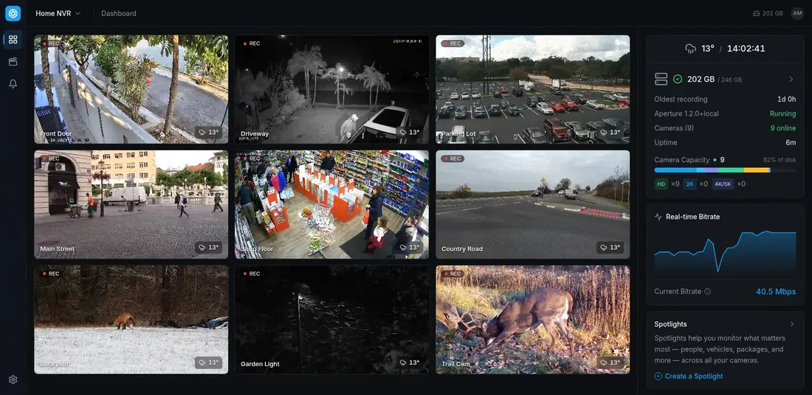
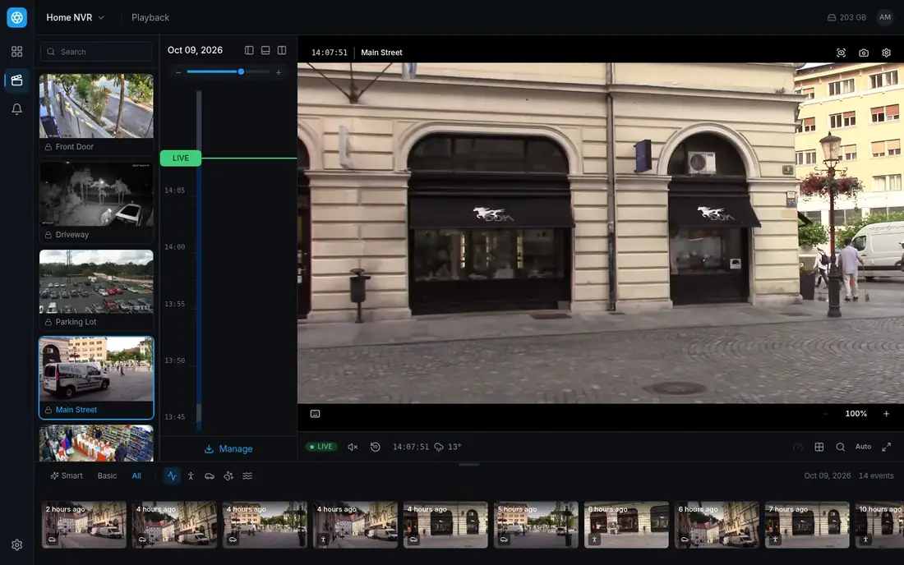
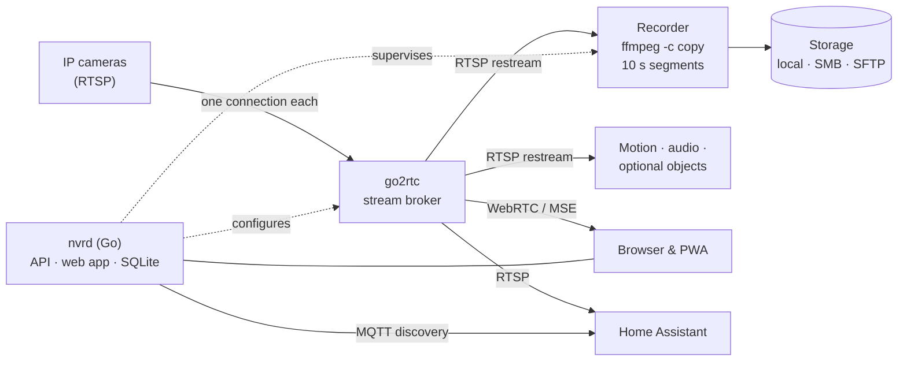

<div align="center">


# Aperture

**A self-hosted NVR that feels like a product, not a project.**

Record your IP cameras around the clock, find any moment in seconds, and watch live from any device —
on your own hardware, with no cloud, no subscription and no Python.


[Features](#features) · [Getting started](#getting-started) · [Architecture](#architecture) · [Development](#development) · [Docs](#documentation)

<br>


<sub>Nine cameras live, with weather, storage health, real-time bitrate and recent detections at a glance.</sub>

</div>

---

## Why Aperture

- **Recording you can trust.** Video is recorded with stream copy — no transcoding, near-zero CPU — and a watchdog restarts anything that stalls. The recording path is treated as load-bearing and nothing risky is allowed near it.
- **One binary, your hardware.** The web app is embedded in a single Go daemon backed by SQLite. Install it as systemd services on any Linux box; nothing phones home.
- **Built for daily use.** A fast, dark, dense UI on desktop and phone, a timeline you can scrub without stutter, and search that gets you to the moment that matters.
- **Lean by default, capable when asked.** Motion detection out of the box; object detection, Home Assistant, ONVIF, HomeKit and extensions are all opt-in.

## Features

### Live view



WebRTC first with an MSE fallback, low-latency sub-streams on the wall and full quality when you open a camera. Streams warm in the background and heal themselves when a camera drops — a feed that goes black reconnects on its own. Camera groups keep large installs tidy, and every tile carries the local weather.

### Playback and timeline



<table>
<tr>
<td width="62%"></td>
<td>

A vertical timeline that scrubs smoothly through days of footage, with coverage, events and a live edge in one rail. Below the player, every event of the day as a thumbnail — filter by people, vehicles, animals or audio and jump straight to it.

- HLS playback with real wall-clock time
- Multi-camera views and grid search by motion area
- Clip export, timelapse and shareable links
- The weather at that moment, reconstructed for any time in the past

</td>
</tr>
</table>

### Events and alarms


Motion with per-camera sensitivity, zones and privacy masks; optional audio detection; and optional object detection that runs only on motion events, so it costs nothing while nothing happens. Filter events by day, night or weather, arm and disarm alarms, and let automations notify you, call a webhook or change how a camera records.

### On your phone

<div align="center">

</div>

A dedicated mobile layout, not a shrunken desktop: the live wall with detection counters, playback with a touch timeline, and the alarm feed. Installs as a PWA with push notifications.

### Security that stays out of your way

<table>
<tr>
<td width="38%"></td>
<td width="62%"></td>
</tr>
</table>

Passkeys, TOTP two-factor and OIDC single sign-on. You stay signed in for months on devices you use, and a device that has passed the code once is remembered — so signing in again there takes only your password. Every signed-in device is listed and can be signed out in one click. Admins and viewers, per-camera access, scoped API tokens, and a tamper-evident activity log.

<table>
<tr>
<td width="50%"></td>
<td width="50%"></td>
</tr>
<tr>
<td><sub><b>Camera passwords never leave the server.</b> Links are shown with the login masked; leave the dots to keep it, type over them to change it.</sub></td>
<td><sub><b>Activity log.</b> Sign-ins, setting changes, deletions and exports, hash-chained so tampering shows.</sub></td>
</tr>
</table>

### System, storage and context

<table>
<tr>
<td width="50%"></td>
<td width="50%"></td>
</tr>
<tr>
<td><sub><b>Health and storage.</b> Every stream's state at a glance; record to several locations at once — local disks, SMB or SFTP shares — with per-destination retention, encryption at rest and a hard space reservation.</sub></td>
<td><sub><b>Location and weather.</b> Pick your site on the map; Aperture records the weather so playback can show the conditions at any moment, plus sunrise, sunset and moon.</sub></td>
</tr>
</table>

### Integrations and extensions

<table>
<tr>
<td width="50%"></td>
<td width="50%"></td>
</tr>
<tr>
<td><sub><b>Home Assistant.</b> Cameras, motion, recording and storage sensors appear in Home Assistant through MQTT discovery, with RTSP restreams and a live-view card. Also ONVIF (for other NVRs) and HomeKit.</sub></td>
<td><sub><b>Extensions.</b> Add panels and background automations in Deno, each sandboxed to the permissions and cameras you approve at install time.</sub></td>
</tr>
</table>

<details>
<summary><b>Everything else</b></summary>

- **Recording:** continuous, motion-only or scheduled per camera; retention and quotas per camera and per destination; HQ/LQ record-quality preference; reindex, purge, backup and restore.
- **Notifications:** web push, notification channels and rules, HMAC-signed webhooks.
- **Platform:** a frozen, versioned `/api/v1` with an OpenAPI spec generated from the route table, a change feed, ETags and idempotency keys.
- **Admin console:** `nvrctl`, a terminal UI and CLI for status, cameras and configuration on the host.
- **Languages:** English and German.

</details>

## Architecture



- **One ingress per camera.** go2rtc holds the only connection to each camera and fans it out to the recorder, detectors, browsers and Home Assistant. Cameras see one client, whatever is watching.
- **`nvrd`** is a single Go daemon: the REST/WebSocket API, the embedded React app, the recorder supervisor, detection, retention and the extension supervisor, all over one SQLite database.
- **Deployment** is native systemd units: `aperture`, `aperture-go2rtc` and `aperture-discovery` (mDNS, so `aperture.local` just works).

| | |
|---|---|
| Backend | Go 1.25, chi, SQLite (modernc, no cgo) |
| Streaming | go2rtc — WebRTC, MSE, HLS, RTSP restream |
| Recording | ffmpeg segment muxer, stream copy |
| Frontend | React 18, TypeScript, Vite, TanStack Query, Tailwind |
| Extensions | Deno, sandboxed per extension |

## Getting started

**Requirements:** a Linux host with systemd (developed on Debian 13), and Go 1.25+ and Node 18+ to build.

```bash
git clone https://github.com/TheOriUHD/aperture.git && cd aperture
make vendor     # fetch the pinned go2rtc and Deno; ffmpeg comes from the system
make install    # build everything and install the systemd units (not started yet)
sudo systemctl start aperture-go2rtc aperture aperture-discovery
```

Then set the two addresses in `/etc/aperture/aperture.env`:

```bash
APERTURE_PUBLIC_URL="https://nvr.example.com"  # how browsers reach Aperture
APERTURE_STREAM_HOST="192.168.1.10"            # the host's LAN IP, for RTSP restreams
```

Open `http://<host>:8971`, create the first administrator, and add your cameras with their RTSP URLs. Configuration and state live in `/etc/aperture` and `/var/lib/aperture`, and both survive upgrades: re-running `make install` is the upgrade.

> A Docker Compose stack (`make up`) still exists for experiments, but native systemd is the supported deployment — see [MIGRATION.md](MIGRATION.md).

## Development

```bash
make run        # the daemon on :8080 (one terminal)
make web-dev    # the Vite dev server on :5173, proxying /api (another terminal)
make test       # Go and frontend tests
make build      # web bundle embedded into the Go binaries
make lint       # go vet
```

```
cmd/nvrd          the daemon            internal/api       HTTP API and access control
cmd/nvrctl        admin TUI and CLI     internal/record    recorder, indexer, mirrors
cmd/apdiscovery   mDNS advertiser       internal/stream    go2rtc orchestration
web/              React app             internal/store     SQLite and migrations
deploy/           systemd, install      internal/ext       extension supervisor
```

## Documentation

- [ONBOARDING.md](ONBOARDING.md) — how the system fits together, the deploy runbook and hard-won gotchas
- [docs/home-assistant.md](docs/home-assistant.md) — the Home Assistant integration
- [docs/detection.md](docs/detection.md) — opt-in object detection
- [docs/extensions](docs/extensions/README.md) — building extensions: manifest, permissions, SDK, panels
- [CHANGELOG.md](CHANGELOG.md) — release history

## Credits

The screenshots come from a demo install fed with freely licensed sample footage from Wikimedia Commons — no real home is shown:
[parking lot](https://commons.wikimedia.org/wiki/File:BLK-HDPTZ12_Security_Camera_Parking_Lot_Surveillance_Video.webm) (Supercircuits, public domain),
[night driveway](https://commons.wikimedia.org/wiki/File:8MP_4K_Dahua_CCTV_System_Sample_Video_-_Night_Time.webm) (Serious Security Sydney, public domain),
[shop floor](https://commons.wikimedia.org/wiki/File:HD_CCTV_Camera_video_3MP_4MP_iProx_CCTV_HDCCTVCameras.net_retail_store.webm) (HDCCTV Cameras, public domain),
[front door](https://commons.wikimedia.org/wiki/File:Ezviz-H8C-4MP_Alarm_Siren_Warning.webm) (Crb Panther, public domain),
[country road](https://commons.wikimedia.org/wiki/File:Gau-Bischofsheim_-_Eine_Minute_an_der_L_415.webm) (ManuelB701, CC0),
[backyard fox](https://commons.wikimedia.org/wiki/File:Red_fox_playing_with_prey_in_yard,_Charlton_MA_2025-12-26.webm) (Peter Cooper Jr., CC0),
[main street](https://commons.wikimedia.org/wiki/File:Road_traffic_on_Stritarjeva_street.webm) (Sounds of Changes, [CC BY 3.0](https://creativecommons.org/licenses/by/3.0/)),
[garden light](https://commons.wikimedia.org/wiki/File:Snow_under_LED_street_light_in_Tuntorp,_Brastad.webm) (W.carter, [CC BY 4.0](https://creativecommons.org/licenses/by/4.0/)) and
[trail cam](https://commons.wikimedia.org/wiki/File:Deer_Sparring_-_trail_cam_footage.webm) (Marty Calabrese, [CC BY 3.0](https://creativecommons.org/licenses/by/3.0/)).
Clips were cropped, scaled and re-encoded. Map data © OpenStreetMap contributors.
